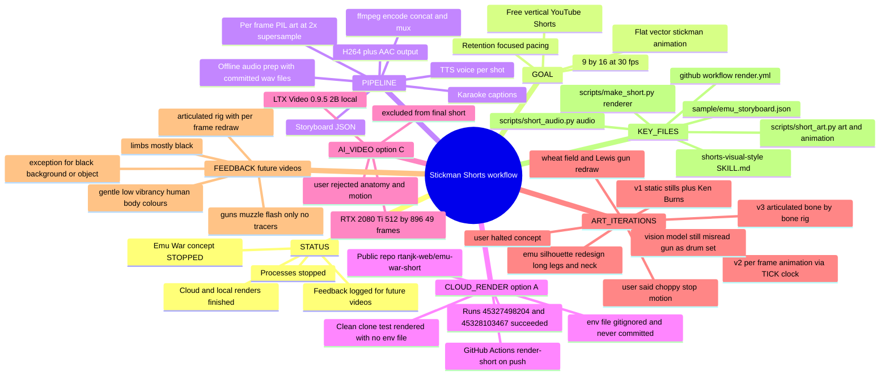

# Session mindmap — stickman Shorts generator

> Single-file history of the whole workflow so a fresh LLM session can pick up instantly.
> Last updated 2026-11-24. **The Great Emu War concept is STOPPED** (user decision).
> Art-direction feedback below applies to **all future** stickman videos.

---

## 1. Status

- **Concept stopped:** user asked to abandon the Great Emu War render and video concept completely on 2026-11-24.
- Both cloud Actions runs completed successfully; nothing is in flight.
- All local Python / ffmpeg processes were stopped.
- The final local MP4 still exists at `C:\Users\rapha\emu_war_short.mp4` (35.37 s, 1080x1920, 30 fps, H.264 + AAC) but is **not to be developed further**.
- Art-direction feedback was logged in `shorts-visual-style/SKILL.md` and in section 6 below.

## 2. Goal and constraints

- Free, engaging vertical YouTube Shorts about historical/topical subjects.
- 9:16, 1080x1920, 30 fps, H.264 + AAC.
- Retention-focused pacing; flat vector stickman identity.
- **No API keys in code.** `.env` is gitignored, never staged or committed.
- Offline CI render path must work with committed `vo_*.wav` files and no TTS quota.

## 3. Pipeline / stack

| Stage | File | Notes |
|---|---|---|
| Storyboard | `sample/emu_storyboard.json` | 8 shots, 16 scenes, narration, camera moves, focus, split |
| Voice + mix | `scripts/short_audio.py` | TTS per shot, `prepare_shots_offline()`, flat music/SFX mix |
| Art + animation | `scripts/short_art.py` | All drawing; global `TICK` clock, `phase()` oscillator, `SS=2` supersampling |
| Render | `scripts/make_short.py` | `shot_frames()` redraws each frame, karaoke captions, encoder probe |
| Encode | local ffmpeg / CI ffmpeg | `h264_mf` on local CapCut ffmpeg, `libx264` on Ubuntu Actions |
| Cloud | `.github/workflows/render.yml` | `render-short` workflow on push, uploads artifact |

CLI: `python scripts/make_short.py --story sample/emu_storyboard.json --out sample/emu --offline`

## 4. Option A — free cloud render (completed, validated)

- Public GitHub repo: https://github.com/rtanjk-web/emu-war-short
- Auth: `gh` CLI as `rtanjk-web`; branch `main`.
- Workflow `render-short` triggers on push; uses Ubuntu free runner + `libx264`.
- Run `45327498204` — success, 3m31s.
- Run `45328103467` — success, 3m36s.
- Clean-clone test in an empty dir with no `.env`: rendered 35.37 s / 1080x1920 / 30 fps in ~148 s.
- Committed tree: 46 files / ~1.68 MB; no prototype media or keys committed.

## 5. Option C — free AI video (evaluated, rejected)

- Local open-weight **LTX-Video 0.9.5 (2B)** on RTX 2080 Ti — no API quota.
- Test settings: 512x896, 49 frames, 24 fps. Generation 26.8-30.9 s; peak VRAM 7.15 GiB; output ~106 KB.
- Fixes made: precompute T5 text embeddings on CPU (device mismatch), create output dir.
- Test clip `C:\Users\rapha\emu_ltx_test.mp4`.
- **User verdict:** "doesnt look accurate" — selected "Subject/anatomy wrong, Motion artifacts". Not used in the final short.

## 6. Emu War concept — art iterations (history only)

1. **v1 static stills + Ken Burns** — user: "Choppy motion, Everything looks off." Adjacent-frame delta ~1.61 (slideshow).
2. **Per-frame animation** — added `TICK`/`phase()`; `render_scene(key, t=...)` redraws subjects every frame (running limbs cycle, body bob, dust/wheat/speed lines). Delta rose to ~2.66.
3. **Emu redesign** — long legs, long neck, small head, drooping tuft (no chicken tail fan); wheat horizon added so the setting reads as a crop field, not a desert.
4. **Lewis gun redraw** — long ribbed barrel, drum magazine, cartridge belt, tripod.
5. **v3 articulated rig** — the user's requested style:
   - one stick per long bone: upper arm / forearm, thigh / shin;
   - ink dot at each elbow/knee joint;
   - round dot hands, oval feet;
   - solid rounded-rectangle torso instead of a spine line;
   - gentle per-frame motion preserved.
6. **Vision-model checks** (Qwen2.5-VL-3B local inspector):
   - birds went from "cartoon chickens" in a "desert" to "cartoon birds" in a "landscape";
   - articulated figures read cleanly with "no anatomical errors";
   - the gun still read as a **"drum set"** in the firing shot (drum magazine + belt + tripod).
7. **User halted the concept** before the proposed gun fix (remove drum, lengthen barrel, muzzle flash only).

## 7. Feedback for future videos (LOGGED — follow these)

### Limb colour
- Draw limbs **mostly black** (`#14161A` ink).
- Exception: when the background or an object the limb interacts with is black / near-black in Pantone terms, lighten the limb so it still reads (paper `#F4F1EA` or a gentle colour).
- Rule: limb and background must contrast; a black limb must never disappear into a black surface.

### Guns / weapons
- **Muzzle flash only.** No tracer rounds, bullet streaks, or cartridge trails.
- Avoid the drum-magazine + belt + tripod combination — it reads as a drum kit. Keep the gun silhouette simple with a clearly long barrel.

### Human body colours
- Use **gentle, low-vibrancy** fills for human bodies/clothing. Mute the secondary blue `#2C7BE5` for people.
- Reserve vibrant accent `#FF5A36` for a single focal element per shot, not for body fills.

### Animation / rig
- Never reuse a single still for a whole shot — redraw subjects every frame.
- Prefer the articulated bone-by-bone rig (section 6, item 5) for all stick figures.

## 8. Key file paths

- Repo: `C:\Users\rapha\AppData\Local\Temp\opencode\stickman-workflow`
- Renderer: `scripts\make_short.py`
- Art: `scripts\short_art.py`
- Audio: `scripts\short_audio.py`
- Storyboard: `sample\emu_storyboard.json`
- CI: `.github\workflows\render.yml`
- Offline voices: `sample\emu\audio\vo_01.wav` … `vo_08.wav`
- Docs: `CLOUD_RENDER.md`, `AI_VIDEO_LOCAL.md`, `MINDMAP.md`
- Style skill (feedback logged here): `C:\Users\rapha\.config\opencode\skills\shorts-visual-style\SKILL.md`
- Final (now dormant) MP4: `C:\Users\rapha\emu_war_short.mp4`
- Rejected AI clip: `C:\Users\rapha\emu_ltx_test.mp4`
